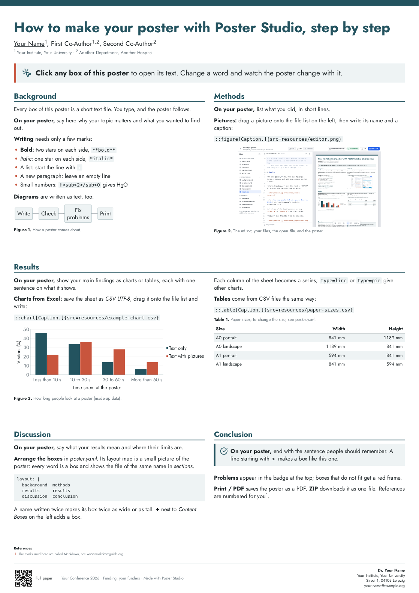

# Poster Studio

Make a scientific poster by writing its text in a few simple text files. You see the poster while you write, place its boxes on a grid, and save it as a PDF. No programming needed.



The example poster explains Poster Studio itself, here in the neutral template. Templates with the logos of an institute come as single files from that institute (see [Templates](#templates)).

## Two ways to work

- **In the browser.** Poster Studio runs completely in your browser: start a poster, edit it, print it as PDF, download it as a ZIP file. Nothing is uploaded. Posters are kept in the browser on this device; download a ZIP to keep a copy. In **Chrome or Edge** the editor can also work directly in a folder on your computer.
- **On your computer, with Git or an AI assistant.** A poster is a folder of text files, so it can be kept under version control (Git) and edited in any text editor or by an AI assistant, while the editor shows the result. We recommend [Visual Studio Code](https://code.visualstudio.com) (free). Do not use Word; on a Mac, TextEdit saves formatted text by default, so it is not suitable either.

Both use the same poster folder, so you can switch at any time: download a ZIP from the browser and unpack it, or open a folder from your computer in the browser.

## Start the editor

If your institute hosts Poster Studio, open its address in **Chrome or Edge** (Firefox and Safari work too, without opening folders). Otherwise run it on your computer:

1. Install **Node.js**, a free program that runs the editor: download the "LTS" version from [nodejs.org](https://nodejs.org) and install it with the default options.
2. Unzip the project folder somewhere on your computer and open a terminal in it:
   - **Windows:** open the folder in Explorer, right-click an empty area, choose **Open in Terminal**.
   - **Mac:** in Finder, right-click the folder and choose **New Terminal at Folder**. If you don't see it, open the Terminal app, type `cd ` (with a space), drag the folder into the window and press Enter.
   - **Visual Studio Code:** open the folder, then **Terminal → New Terminal**.
3. Type `npm install` and press Enter. Wait until it has finished (about a minute). This is needed only once.
4. Type `npm run dev` and press Enter. The editor opens in your browser. Keep the terminal open while you work; when you are done, close it.

On your computer, the editor also lists the poster folders in `examples/` and `posters/` (and in a folder named by the environment variable `POSTERS`). Changes to their files, made in the editor or elsewhere, are saved to disk and shown at once.

## The example poster

When you open the editor in a new browser window, it starts with an example poster that explains how everything works, box by box: writing, pictures, charts and tables, diagrams, arranging the boxes, problems, printing. Click any box of it to see the text behind it, and try changing it; nothing you do there is kept. **Keep as my poster** at the top stores a copy in the browser and continues with it. Later, **Open the example** on the start screen (**←** at the top left) shows it again.

## Make your own poster

In the editor: under **New poster**, type a name, choose a template and click **Create**. To use a template file you got from your department, click **Use a template file…** first; it is kept in your browser for next time. In Chrome or Edge, **Create in a folder…** writes the poster into an empty folder on your computer instead. A new poster starts as a copy of the example poster: each box says what belongs into it on a real poster, so you replace the text box by box.

On your computer you can also copy the folder `examples/welcome` into `posters/` and rename it, for example `posters/dgim-2027` (no spaces).

Put your material into the poster's `resources` folder (in the editor: drag the files onto the file list): pictures, tables saved from Excel as **CSV UTF-8**, papers. Then replace the example text with yours.

## A poster is a folder

| File | What it holds |
|---|---|
| `header.md` | Title, authors, affiliations, key message |
| `sections/*.md` | One file per box: Background, Methods, … |
| `footer.md` | Logos or QR code, conference and funding, contact |
| `poster.yaml` | Where the boxes go (the layout map), language, size and colour changes |
| `template.html` | The design. Leave it unchanged; it is a copy of a template file |
| `resources/` | Pictures, CSV files, papers |

## Writing the text

The files are plain text with a few markers ("Markdown"). Start from the example and change it step by step.

| What | How you write it |
|---|---|
| Title, authors, affiliations | In `header.md`: `# Title`, then a line of authors, then a line of affiliations. `<sup>1</sup>` makes a small raised number, `<u>Name</u>` underlines the presenting author. |
| Key message across the full width | In `header.md`, a line starting with `> ` after the affiliations |
| Section | `## Methods` |
| Sub-heading | `### Patients` |
| Bold, italic | `**bold**`, `*italic*` |
| List | Lines starting with `- ` |
| Highlighted box | A line starting with `> ` |
| Icon in a box | `> [!goal] Our aim is …`: the name of any icon on [lucide.dev/icons](https://lucide.dev/icons), for example `goal`, `lightbulb`, `flask-conical`, `circle-check-big` |
| Reference | `[^smith]` in the text and `[^smith]: Smith A. Title. Journal. 2025;1:1–10.` in the same or any other file. References are numbered automatically and listed in small print above the footer. |
| Picture | `::figure[What the picture shows.]{src=resources/photo.jpg}`, or with a title as shown below. Add `width=70%` to make the picture smaller. |
| Table from Excel | Save the sheet as **CSV UTF-8**, then `::table[Caption.]{src=resources/table.csv}` |
| Chart from Excel | `::chart[Caption.]{src=resources/data.csv type=bar}` (see below) |
| Small table typed by hand | <code>&#124; Group &#124; n &#124;</code> lines, see [Markdown tables](https://www.markdownguide.org/extended-syntax/#tables) |
| Diagram (flow chart, timeline, …) | A block starting with ` ```mermaid ` and ending with ` ``` `. Try diagrams in the [Pele playground](https://pele.run/playground); the syntax is explained in the [Mermaid documentation](https://mermaid.js.org/intro/). For a caption, put `:::figure[Caption.]` on the line above the block and `:::` on the line below it. |
| Footer | In `footer.md`. Pictures (institute logos, a QR code) appear on the left: ` Full paper`. The **last paragraph** is the contact block; end each line with a backslash `\` to start a new line. |
| Note that is not printed | `<!-- your note -->` |

**Pictures with a title:** write the title, the picture and the caption between `:::figure` and `:::`, with an empty line between them:

```
:::figure{width=80%}
Readmissions fell with telemonitoring.


**Readmissions within 90 days.** Mean ± SEM, \*\*p < 0.01, n = 120 per group.
:::
```

`width` makes only the picture smaller; title and caption keep the full width of the box. Stars for significance need a backslash (`\*`), otherwise they make text bold.

**Charts from Excel:** the first column holds the labels, every further column becomes one bar or line, with its column heading in the legend. For example:

```
Reason,Telemonitoring,Usual care
Heart failure,9,19
Other cardiovascular,5,7
```

`type` can be `bar`, `line` or `pie`. Add `y="Patients (n)"` for an axis title, `horizontal` for horizontal bars (good for long labels), or `width=80%` to make the chart narrower. Decimal commas are fine; leave out thousands separators.

Write file names exactly as they are, including capital letters, and avoid spaces in them. All the details: [docs/poster-format.md](docs/poster-format.md).

## Placing the boxes: the layout map

`poster.yaml` contains a small picture of the poster below the header. Every name is a box and shows the file `sections/<name>.md`:

```yaml
layout: |
  background  results     results
  methods     results     results
  methods     discussion  conclusion
```

- Repeat a name to make its box wider or taller; a box must be a rectangle.
- A box that is two columns wide sets its text in two columns. `---` on its own line (with an empty line above it) starts its next column.
- A dot `.` leaves a space empty.
- `rows: auto 1fr auto` sets the heights of the rows: `auto` fits the content, `1fr` takes the space that is left.
- A box as wide as the poster works as a row of its own: its heading spans the box, its text runs in columns below.
- The poster is read in rows from top to bottom (a new row starts where no box crosses the line) and within a row column by column; figures and references are numbered in this order.

To add a box, click **+** next to *Content Boxes* in the editor (or create a file in `sections/`) and add its name to the map.

## Does everything fit?

The editor shows the poster at its print size, scaled to fit. **Edit**, **Split** and **Preview** at the top switch between writing, both side by side, and the poster alone. In the preview:

- **Ctrl + mouse wheel** (Mac: **⌘ + scroll**) or pinching on a trackpad zooms at the pointer; the buttons at the bottom zoom, fit the width, or show the whole poster. With the preview clicked, **+**, **−**, **0** (fit width) and **9** (whole poster) work too.
- Drag to move the poster around.
- Click a box (or the header or footer) to open its file.

The badge at the top and the list below the text show problems: an unknown block, a file that is missing, a box whose text does not fit (the box gets a red dashed outline in the preview). Click a problem to go to its line.

**The title should fit on two lines.** If it needs three, shorten it or lower the title size (see the next section).

If a box does not fit: shorten the text, make pictures smaller (`width=70%`), give the box more room in the layout map, or choose a smaller text size.

## Size, language and colours

Changes go into `poster.yaml`, below `settings:`. The possible names are in the SETTINGS block at the top of `template.html`, each with a short explanation:

```yaml
lang: de          # German poster: correct hyphenation, "Abb." and "Tab."
settings:
  font-size: 30pt
  title-size: 70pt
  width: 594mm    # A1 portrait: 594mm × 841mm
  height: 841mm
```

## Saving as PDF

1. Click **Print / PDF** (or press **Ctrl + P**, Mac: **⌘ + P**).
2. Destination: **Save as PDF**. The paper size is set automatically.
3. Margins: **Default** (or **None**). Scale: **Default**.
4. Click **Save**. Open the PDF and check it before you send it to the print shop.

## Templates

A template is a single HTML file with the whole design: colours, fonts, logos. A department can publish its template as one file; every poster keeps a copy as `template.html`.

This repository contains only the neutral template (`templates/neutral.html`, no logos). Templates with logos, such as the one of the Medical Faculty and the University Hospital Leipzig (UKL), may not be published with the code; they are passed on as files:

- **For a new poster:** on the start screen, **Use a template file…**. The template stays in your browser and appears next to the others.
- **For a poster you already have:** open `template.html` in the file list and choose **Use another template…** above the text.
- **On your computer:** put the file into `templates/`; `npm run dev` offers it, and Git and Docker ignore it.
- **For everyone using your installation:** put it on the server (see [Putting Poster Studio online](#putting-poster-studio-online)).

Making a template takes HTML and CSS: see [docs/template-format.md](docs/template-format.md).

## With an AI assistant (optional)

An AI assistant can draft the poster from your material. Each poster folder contains `AGENTS.md`, which tells assistants how the poster works; in this project, `.claude/skills/poster/SKILL.md` adds the whole workflow: read all material, write the files, use your CSV files for charts and tables instead of retyping numbers, and list every number with its source.

With [Claude Code](https://claude.com/claude-code), open the project folder and type for example:

```
/poster posters/dgim-2027: A0 portrait, in German, focus on the primary outcome
```

Other assistants can be pointed to the same files. **Always check every number on the poster yourself.**

## Good to know

- The templates use the free font Jost (SIL Open Font License, see `templates/OFL-Jost.txt`), a close relative of Futura.
- For a template with the logos of an institute, check with its communications team before printing for an external event.
- The PDF uses RGB colours and contains the fonts. Most print shops accept this.
- Diagrams and charts are drawn by [Pele](https://github.com/obsidianmd/pele), which understands most Mermaid diagram types.
- The icons are from [Lucide](https://lucide.dev) (free, ISC licence).

## Putting Poster Studio online

The editor is a static website: everything runs in the browser, and posters never reach the server. The `Dockerfile` builds it (after the engine's tests pass) and serves it with nginx on port 80. It needs no database, no volumes and no environment variables.

**With [Coolify](https://coolify.io):**

1. Push this repository to a Git server that Coolify can reach (GitHub, GitLab, Gitea, …).
2. In Coolify, add a new resource from that repository and branch.
3. Choose **Dockerfile** as the build pack (the Dockerfile is at the top of the repository).
4. Set **Ports Exposes** to `80` and add your domain; Coolify takes care of HTTPS.
5. Deploy. The health check in the Dockerfile tells Coolify when the editor is up. With automatic deployment switched on, every push builds a new version.

**On any other Docker host:** `docker build -t poster-studio .`, then `docker run -d -p 8080:80 poster-studio` and open port 8080.

The image contains the editor, the example poster and the neutral template. The folder `posters/` and templates with logos are never included. `deploy/nginx.conf` sets the caching (built files for a year, everything else checked on each visit) and security headers: scripts may only come from the site itself.

**Offering more templates on the server.** The editor lists every `.html` file in the site's `templates/` folder (`/usr/share/nginx/html/templates/` in the container). In Coolify, add a file mount under **Persistent Storage** for each template, for example `/usr/share/nginx/html/templates/ukl.html`. The template then reaches everyone who can open your installation, so put templates with logos only on an installation that is meant for the people allowed to use them.

## For developers

npm workspaces in TypeScript (shared settings in `tsconfig.base.json`); check types with `npm run typecheck`.

- `packages/engine` turns a poster folder into one self-contained HTML page. `build()` (Markdown to HTML with [unified](https://unifiedjs.com), the layout map to a CSS grid, the template's slots) runs in Node and in the browser; `finish()` (`@poster-studio/engine/finish`) completes the page in a DOM: diagrams with Pele, the `@page` size, overflow checks. Tests: `npm test`.
- `packages/app` is the editor ([Preact](https://preactjs.com), [CodeMirror](https://codemirror.net)). Poster sources: the dev server's folders (`vite-posters.ts`), a folder through the File System Access API, IndexedDB, and ZIP files ([fflate](https://github.com/101arrowz/fflate)). The preview is a sandboxed iframe with a Content Security Policy: no scripts, no network.
- `npm run dev` starts the editor with the poster folders on this computer; `npm run build` builds it as a static site (`packages/app/dist`) that works from any folder of a web server, and `npm run preview` serves that build.
- `templates/` holds the template files: in the repository only `neutral.html` and the font licence, locally also your own (ignored by Git and Docker). `scripts/inline-assets.mjs` inlines fonts and pictures into a template.
- `examples/welcome` is the example poster: it opens at the start of a browser session (in memory, `#example`) and is the starter for new posters; its `template.html` must equal `templates/neutral.html` (a test checks this).

## License

[MIT](LICENSE). The font Jost in the templates is under the SIL Open Font License ([templates/OFL-Jost.txt](templates/OFL-Jost.txt)); templates you add keep their own terms.
