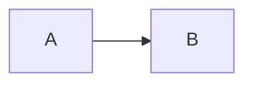

# The poster format

A poster is a folder. The same folder works in the browser editor, on your computer and as a ZIP file (the ZIP holds the folder).

```
my-poster/
  poster.yaml          template, language, settings, layout map
  template.html        the design: one file, a copy of a template (see template-format.md)
  header.md            title, authors, affiliations, key message
  footer.md            logos or QR code, notes, contact
  sections/<name>.md   one file per box of the layout map
  resources/           pictures, CSV files, papers; everything the text refers to
  AGENTS.md            instructions for AI assistants (optional)
```

Paths in the Markdown files are relative to the poster folder: `resources/photo.png`, also in `sections/*.md`. File names must match exactly, including capital letters.

## poster.yaml

```yaml
template: template.html        # optional, this is the default
lang: en                       # en, de, …: hyphenation, and the labels Fig./Abb.
variant: compact               # optional: a variant, if the template offers one (one name or a list)
settings:                      # optional: changes values of the template's SETTINGS block
  font-size: 30pt
  gap: 15mm
layout: |                      # required; the vertical bar keeps the rows on separate lines
  background  results     results
  methods     results     results
  methods     discussion  conclusion
rows: auto auto 1fr            # optional: heights of the rows (default: auto for every row)
columns: 1fr 1fr 1fr           # optional: widths of the columns (default: equal widths)
text-columns:                  # optional: text columns inside a box (default: the grid columns it spans)
  results: 1
order: [background, methods, results, discussion, conclusion]   # optional: reading order
```

### The layout map

The layout map is a picture of the boxes below the header:

- Every name is a box, filled from `sections/<name>.md`. Names use letters, digits and `-` and start with a letter.
- A name repeated over several cells makes the box wider or taller. It must cover a rectangle.
- `.` leaves a cell empty.
- All rows have the same number of cells.

The map becomes CSS `grid-template-areas`, so the template author and the browser read it the same way.

**Rows and columns.** `rows` and `columns` take CSS track sizes, one per row or column of the map (the editor warns when the numbers differ). `auto` fits the content; `1fr`, `2fr` share what is left in that ratio; lengths like `250mm` are fixed. With the default (`auto` for every row) each box is as tall as its content, and spare space is shared out equally. `rows: auto 1fr auto` gives all spare space to the middle row.

**Text columns.** A box spanning two grid columns sets its text in two columns, so lines stay short enough to read; its first heading spans all of them. `text-columns` changes that per box. In a box with several text columns, `---` on its own line (with an empty line above) starts the next column, and `wide` on a figure (`{… wide}`) spans all of them.

**Reading order.** The poster is read in horizontal bands from top to bottom, and within a band column by column (by the top-left cell of each box). A band ends at a row line that no box crosses, so boxes as wide as the poster below the columns come after them. The reading order decides the numbers of figures, tables and references. `order` lists boxes that come first, in this order; the others follow.

**One flowing box.** A poster whose text simply flows through two columns is a single box: `layout: main` with `sections/main.md` and `text-columns: { main: 2 }`.

## header.md

```markdown
# Title of the poster, at most two lines

<u>Presenting Author</u><sup>1</sup>, Second Author<sup>1,2</sup>

<sup>1</sup> Institute · <sup>2</sup> Department

> **The key message** in one sentence.
```

The template decides how these appear; a paragraph after the first one is usually the affiliations, the quote is the key message across the full width.

## footer.md

Pictures (institute logos, a QR code) and short notes; the last paragraph is the contact block. End a line with `\` to start a new line within a paragraph.

## Markdown in all files

CommonMark with GitHub's tables, strikethrough (`~~text~~`) and footnotes. A single `~` stays as it is ("~5 %").

| What | How |
|---|---|
| Section, sub-heading | `## Methods`, `### Patients` |
| Bold, italic | `**bold**`, `*italic*` |
| List | lines starting with `- ` |
| Highlighted box | a line starting with `> ` |
| Icon on a highlighted box | `> [!goal] Text`: any icon name from [lucide.dev/icons](https://lucide.dev/icons) |
| Reference | `[^smith2025]` in the text and `[^smith2025]: Smith A. Title. Journal. 2025;1:1–10.` in any file; numbered automatically across all files, in reading order. The template prints the list (the included templates: in small print above the footer); without a place for it in the template, it ends the last box |
| Raised or lowered text, underline, line break | `<sup>1</sup>`, `H<sub>2</sub>O`, `<u>Name</u>`, `<br>`; no other HTML |
| Note that is not printed | `<!-- note -->` |
| Diagram | a ```` ```mermaid ```` code block ([Mermaid syntax](https://mermaid.js.org/intro/), drawn by [Pele](https://pele.run/playground)) |

`<` and `{` are ordinary characters: `p<0.05` and `{x}` are fine. `*` around words makes them italic; write `\*` for a star (`\*\*\*p < 0.001`).

### Blocks

Blocks start a line with `::` (or `:::` around content). The text in `[…]` is the caption and may contain Markdown; the settings go into `{…}`.

| Block | Example |
|---|---|
| Picture | `::figure[What the picture shows.]{src=resources/photo.png}` |
| Narrower picture | `::figure[Caption.]{src=resources/photo.png width=70%}` |
| Picture over all text columns of a box | `::figure[Caption.]{src=resources/photo.png wide}` |
| Table from a CSV file | `::table[Caption.]{src=resources/table.csv}` |
| Chart from a CSV file | `::chart[Caption.]{src=resources/data.csv type=bar y="Patients (n)"}` |
| Captioned diagram, or a picture with a title above it | see below |

**Charts:** the first column holds the labels, each further column is one series (its heading goes into the legend). `type` is `bar` (default), `line` or `pie`; `horizontal` gives horizontal bars; `y` is the axis title; `width` makes the chart narrower. CSV files may use commas, semicolons (German Excel) or tabs, and decimal commas.

**`:::figure` with content.** Paragraphs above the picture are its title, paragraphs below it its caption; a caption in `[…]` replaces the paragraphs below. The picture is an image (``) or a diagram:

````markdown
:::figure{width=80%}
Repair takes place within the first 30 minutes.


**Overpressure induces membrane damage.** Control [C] vs pressure [P], mean ± SEM, n = 23–24.
:::

:::figure[Study flow.]

:::
````

## Problems

The editor checks the poster after every change and lists problems with file and line:

- errors in `poster.yaml` and the layout map (with the line in `poster.yaml`);
- unknown blocks, missing files (with a hint if only capital letters differ), unknown icons;
- boxes whose content does not fit (outlined in red in the preview), boxes taller than the space for them, anything beyond the page.

Nothing stops the preview: the rest of the poster is still shown.
