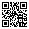

<!-- The bottom of the poster. Pictures (logos, a QR code) appear on the left; replace resources/qr-code.svg
     with your own QR code. The last paragraph is the contact block: a backslash \ at the end of a line starts a new line. -->

 Full paper

Your Conference 2026 · Funding: your funders · Made with Poster Studio

**Dr. Your Name**\
Your Institute, Your University\
Street 1, 04103 Leipzig\
your.name@example.org
