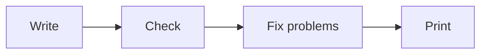

<!-- The box "background" (see the layout map in poster.yaml).
     On your own poster: why the topic matters and what you wanted to find out. -->

## Background

Every box of this poster is a short text file. You type, and the poster follows.

**On your poster,** say here why your topic matters and what you wanted to find out.

**Writing** needs only a few marks:

- **Bold:** two stars on each side, `**bold**`
- *Italic:* one star on each side, `*italic*`
- A list: start the line with `- `
- A new paragraph: leave an empty line
- Small numbers: `H2O` gives H2O

**Diagrams** are written as text, too:

:::figure[How a poster comes about.]

:::
